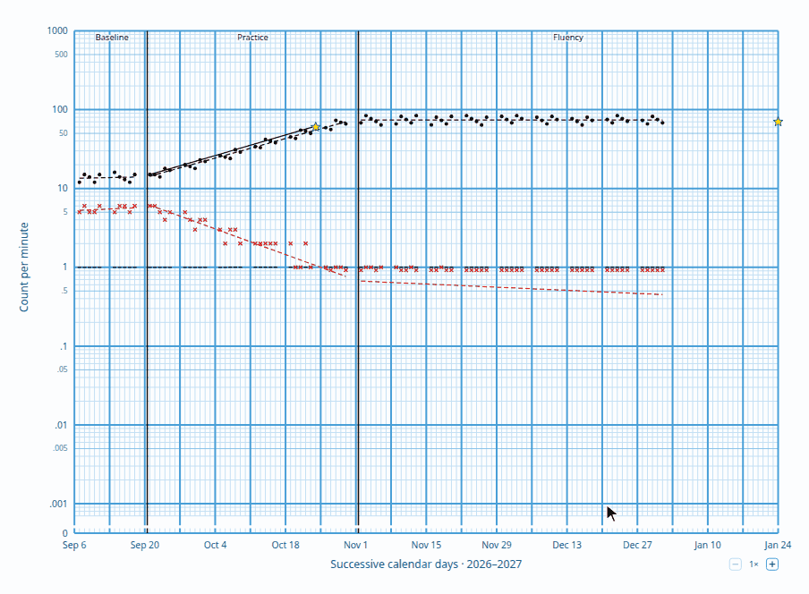

# @fluency-education/scc

A TypeScript library for creating Standard Celeration Charts (SCC): daily
per-minute charts of corrects, errors and record floors, with phases, aims,
learning lines and best fit lines.



## Quickstart

```sh
npm install @fluency-education/scc
```

`renderChart` returns the chart as an SVG string, so it runs anywhere,
including on a server. The SVG fills the width of its container.

```ts
import { renderChart } from "@fluency-education/scc";

const svg = renderChart({
  startDate: "2026-09-07",
  // One entry per day from startDate. -1 marks a day with nothing recorded.
  timingSeconds: [60, 60, 60, -1, 60],
  corrects: [12, 15, 14, -1, 18],
  errors: [4, 3, 3, -1, 1],
  phases: [
    { name: "Baseline", endDay: 1 },
    { name: "Practice", aim: 40, celeration: 1.25 },
  ],
});
```

Each day's counts are divided by its timing to plot them per minute. A timing
also sets the day's record floor: one count in that timing.

## API

### `renderChart(options?: ChartOptions): string`

Returns the chart as an SVG string. The SVG fills the width of its container
and keeps its proportions. With no options, it draws an empty chart.

`renderChart` draws the data exactly as given and never leaves data out or
guesses what was meant. For anything it can't draw, it throws a `TypeError` or
`RangeError` that names the day and what is wrong with it.

#### `ChartOptions`

| Option | Type | Description |
|---|---|---|
| `corrects` | `number[] \| null` | Correct counts, one per day from day 0, drawn as dots with a best fit line. Each is a whole number of 0 or more, or `-1` for a day with nothing recorded. Leave it out or pass `null` to plot errors alone. |
| `errors` | `number[] \| null` | Error counts, drawn as an X with a red best fit line. Same format as `corrects`. Leave it out or pass `null` to plot corrects alone. |
| `timingSeconds` | `number[]` | Length of each day's timing in seconds, from 0.06 to 60000, or `-1` for a day without a timing. Counts are divided by it to plot them per minute, and it sets the day's record floor: one count in that timing. Needed with `corrects` or `errors`. |
| `phases` | `Phase[]` | Consecutive phases from day 0. See [`Phase`](#phase). |
| `startDate` | `CalendarDate` | The date of day 0. With it, the axis and cards show dates instead of day numbers, and the chart starts on the Sunday on or before it so weeks run Sunday to Saturday. |

The daily lists (`corrects`, `errors` and `timingSeconds`) also follow these
rules together:

- Every list you pass has one entry per day, so they are all the same length.
- `-1` indicates that a day doesn't have any data to plot (no timing). On that
  day, every list you pass must have a `-1`. Otherwise, each list should have a
  value `>=0`.
- No count can be more than 1000 per minute.
- Every value in the array is a number. `null`, `undefined`, `NaN` and strings like `"12"`
  are rejected, so convert data from forms or JSON first.
- The data must fit on the chart's 141 days, or fewer with a `startDate` later
  in its week, as the chart starts on the Sunday before.

#### `Phase`

| Field | Type | Description |
|---|---|---|
| `name` | `string` | Written near the top of the chart within the phase. |
| `endDay` | `number` | The last day of the phase, a whole day on the chart, on or after the phase's first day. Every phase but the last needs one, and a phase line is drawn after it. No phase line is drawn for the last phase. |
| `aim` | `number` | Optional target count per minute, from .001 to 1000, drawn as a star. |
| `celeration` | `number` | Optional target celeration per week, above 0, such as `2` for ×2 or `0.5` for ÷2. Drawn as a learning line from the phase's first correct until it reaches the aim, or to the end of the phase without one. |

#### `CalendarDate`

`Date | string`: a `Date`, read in local time, or a `"YYYY-MM-DD"` string. Only
the year, month and day count.

### `enableZoom(svg: SVGSVGElement): () => void`

Shows the chart's zoom buttons and lets the zoomed chart be dragged to pan.
Returns a function to remove it.

### `enableHover(svg: SVGSVGElement): () => void`

Shows a card of details while the pointer is over each mark and line. Returns a
function that removes hover.

Both take the `<svg>` element from `renderChart` once it is in the page:

```ts
import { enableHover, enableZoom, renderChart } from "@fluency-education/scc";

const container = document.querySelector("#chart")!;
container.innerHTML = renderChart(options);
const chart = container.querySelector("svg")!;
const disableZoom = enableZoom(chart);
const disableHover = enableHover(chart);
```

### Styling

The chart carries its own styles in a `<style>` inside the `<svg>`. Every rule is
scoped under the root `<svg>`'s `scc` class, so it styles only the chart and none
of the rest of the page. To restyle part of the chart, use a selector more
specific than the chart's own, such as `#chart .scc .grid { stroke: #999; }`.

## Examples

[`examples/index.html`](examples/index.html) shows each of these in a working
page: an empty chart, plotted data, phases with zoom and hover cards, and a chart
that re-renders as its data is edited. To open it, clone this repository and run
`npm run example`.

## Development

```sh
npm install
npm test          # run tests once (vitest)
npm run typecheck # type-check with tsc
npm run build     # compile to dist/ with tsc
npm run preview   # write a sample chart to preview/index.html
npm run example   # serve examples/index.html on a local port
npm run bench     # time dragging and hovering in headless Chrome
```

## Author
This project was developed by [Clayton Schneider](https://github.com/clayton-schneider).

**Disclaimer:** This library was developed with the assistance of an LLM.
